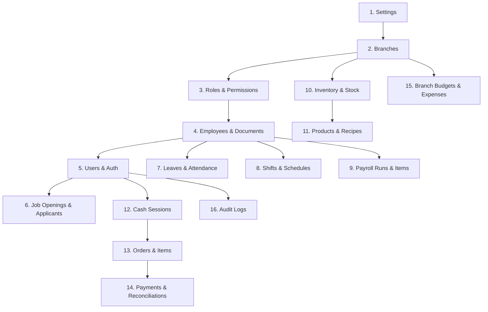

# Fika Café HRMS & POS — Master Data Mapping Specification (Phase 17A)

This document provides the definitive data migration mapping specification from the legacy Fika database schemas (`hrms (1).sql`, `db_schema.sql`, and `cafe_pos.sql`) to the modern, modular `rebuild/core` schema.

---

## 1. Architectural Overview & Migration Strategy

The rebuild architecture replaces fragmented, procedural tables with a normalized, branch-scoped domain architecture:
1. **Core Administration & Security (`app/core`):** Strict PAM RBAC (`roles`, `permissions`, `role_permissions`), session fixation protection, and unified `users` table.
2. **HRMS & Biometrics (`fika_hrms`):** Device-bound biometric logs (`attendance_logs`), overtime/tardiness formulas, shift board scheduling (`shifts`, `open_shifts`), leave ledgers (`leave_requests`), and statutory payroll calculations (`payroll_runs`, `payroll_items`).
3. **Supply Chain & Inventory (`fika_inventory`):** Unified inventory items (`inventory_items`), branch stock levels (`inventory_stock`), immutable double-entry movement ledger (`inventory_ledger`), and multi-item purchase orders (`purchase_orders`, `purchase_order_items`, `po_receipts`).
4. **POS & Catalog (`fika_pos`):** Product catalog (`products`, `categories`), modifier groupings (`modifiers`), Bill-of-Materials recipes (`recipes`), register float reconciliation (`cash_sessions`), and atomic order deductions (`orders`, `order_items`, `order_item_modifiers`, `order_ledger_deductions`).
5. **Finance & Treasury (`fika_finance`):** Operating budgets (`branch_budgets`), expenses with dynamic Maker-Checker threshold approvals (`expenses`, `expense_categories`), and automated payment anomaly reconciliations (`payments`, `reconciliation_logs`).

---

## 2. Universal Data Transformation & Cleanliness Rules

| Transformation Category | Legacy Source Rule | Rebuild / Target Rule | Implementation Detail |
| :--- | :--- | :--- | :--- |
| **Monetary Currency** | Floating-point pesos (`FLOAT`, `DECIMAL(10,2)` or `DOUBLE`) | Integer centavos (`BIGINT` or `INT`) | `*_cents = ROUND(CAST(val AS DECIMAL(12,2)) * 100)`. Completely eliminates IEEE-754 floating-point rounding drift. |
| **User Passwords** | Bcrypt hash strings (`$2y$10$...`) in `users.password` | Bcrypt hash strings in `users.password` (`password_hash`) | Copied directly. PHP 8 `password_verify()` natively validates existing hashes without requiring forced user password resets. |
| **Role Assignment** | Loose string names (`System Admin`, `Cashier`, `Central HR`, etc.) | Foreign key to `roles.id` | Mapped to canonical PAM roles: `ADMIN` (1), `CHR` (2), `GA` (3), `BA` (4), `BHR` (5), `BM` (6), `STAFF` (7). |
| **Cryptographic PII** | Plaintext statutory numbers and bank details | AES-256-CBC encrypted ciphertext with HMAC-SHA256 signature | Encrypted via `Crypto::encrypt($plaintext)`. Applies to `bank_account`, `tin`, `sss`, `philhealth`, `pagibig`. |
| **Time & Durations** | Fractional hours (`overtime_hours`, `undertime_hours`) | Integer minutes (`overtime_minutes`, `undertime_minutes`) | `*_minutes = ROUND(val * 60)`. |
| **Status Enums** | Mixed-case strings (`Active`, `Pending`, `Probationary`, `Paid`) | Uppercase canonical ENUM values | Standardized via `UPPER(TRIM(status))`. |
| **Null Standardization** | String `"NULL"`, `"None"`, `"N/A"`, or empty string `""` | Database `NULL` | Sanitized to native `NULL` across all foreign keys and optional descriptors. |

---

## 3. Comprehensive Table & Field Mapping Matrix

### 3.1 Core Administration & Organization

#### Legacy Table: `branches` &rarr; Target Table: `branches`
*Anchor Table for all store-level data scoping.*

| Old Column | New Table | New Column | Transformation / Notes |
| :--- | :--- | :--- | :--- |
| `id` | `branches` | `legacy_id` | Stored as `legacy_id INT NULL UNIQUE`. New auto-increment `id` assigned. |
| `name` | `branches` | `name` | Direct mapping. Trimmed. |
| `address` | `branches` | `address` | Direct mapping. |
| `contact_number` | `branches` | `phone` | Renamed to `phone`. |
| `status` | `branches` | `status` | Mapped to ENUM: `'Active'` &rarr; `'ACTIVE'`, `'Inactive'` &rarr; `'INACTIVE'`. Default `'ACTIVE'`. |
| `created_at` | `branches` | `created_at` | Preserved as DATETIME. |

#### Legacy Table: `roles` &rarr; Target Table: `roles`

| Old Column | New Table | New Column | Transformation / Notes |
| :--- | :--- | :--- | :--- |
| `id` | `roles` | `legacy_id` | Stored as `legacy_id INT NULL`. Mapped to canonical PAM Role ID (1-7). |
| `name` | `roles` | `name` | Mapped: `'System Admin'`, `'Super Admin'` &rarr; `ADMIN` (1); `'Central HR'`, `'HR'` &rarr; `CHR` (2); `'Global Accountant'` &rarr; `GA` (3); `'Branch Accountant'` &rarr; `BA` (4); `'Branch HR'` &rarr; `BHR` (5); `'Branch Manager'` &rarr; `BM` (6); `'Barista'`, `'Head Barista'`, `'Cashier'`, `'Staff'` &rarr; `STAFF` (7). |

#### Legacy Table: `users` &rarr; Target Table: `users`

| Old Column | New Table | New Column | Transformation / Notes |
| :--- | :--- | :--- | :--- |
| `id` | `users` | `legacy_id` | Stored as `legacy_id INT NULL UNIQUE`. New auto-increment `id` assigned. |
| `name` | `users` | `name` | Direct mapping (if empty, derived from linked employee or username). |
| `username` | `users` | `username` | Direct mapping. Converted to lowercase, trimmed. |
| `email` | `users` | `email` | Direct mapping. Validated email string. |
| `password` | `users` | `password` | Direct mapping. Bcrypt hash preserved as-is. |
| `role_id` | `users` | `role_id` | Mapped via legacy role name string to modern PAM `roles.id` (1–7). |
| `employee_id` | `users` | `employee_id` | Resolved via `employees.legacy_id` &rarr; new `employees.id`. Nullable. |
| `branch_id` | `users` | `branch_id` | Resolved via `branches.legacy_id` &rarr; new `branches.id`. Nullable for HQ roles. |
| `verified` | `users` | `verified` | Mapped to TINYINT: `1` if verified, `0` otherwise. |
| `created_at` | `users` | `created_at` | Preserved as DATETIME. |
| `last_login` | `users` | `last_login_at` | Preserved as DATETIME. |

#### Legacy Table: `activity_logs` &rarr; Target Table: `audit_logs`

| Old Column | New Table | New Column | Transformation / Notes |
| :--- | :--- | :--- | :--- |
| `id` | `audit_logs` | `legacy_id` | Stored as `legacy_id INT NULL UNIQUE`. |
| `user_id` | `audit_logs` | `user_id` | Resolved via `users.legacy_id` &rarr; new `users.id`. Nullable. |
| `action` | `audit_logs` | `action` | Upper-cased string (e.g., `'LOGIN'`, `'UPDATE_PROFILE'`). |
| `details` | `audit_logs` | `details` | Preserved as TEXT. |
| `created_at` | `audit_logs` | `created_at` | Preserved as DATETIME. |

---

### 3.2 Human Resources & Personnel Management

#### Legacy Table: `employees` &rarr; Target Table: `employees`

| Old Column | New Table | New Column | Transformation / Notes |
| :--- | :--- | :--- | :--- |
| `id` | `employees` | `legacy_id` | Stored as `legacy_id INT NULL UNIQUE`. New auto-increment `id` assigned. |
| `employee_id` | `employees` | `employee_code` | Preserved as unique formatted code (e.g., `'EMP-2026-001'`). |
| `first_name` | `employees` | `first_name` | Direct mapping. Trimmed. |
| `last_name` | `employees` | `last_name` | Direct mapping. Trimmed. |
| `email` | `employees` | `email` | Direct mapping. Validated email. |
| `phone` | `employees` | `phone` | Direct mapping. Standardized phone format. |
| `position` | `employees` | `position` | Direct mapping (e.g., `'Head Barista'`, `'Branch Accountant'`). |
| `department` | `employees` | `department` | Direct mapping (e.g., `'Operations'`, `'Finance'`, `'Human Resources'`). |
| `employment_type` | `employees` | `employment_type` | Standardized to ENUM: `'Full-Time'` &rarr; `'FULL_TIME'`, `'Part-Time'` &rarr; `'PART_TIME'`. |
| `employment_category` | `employees` | `staff_class` | Mapped: Store personnel &rarr; `'STORE'`; Executive/HQ &rarr; `'HEAD_OFFICE'`. |
| `employment_status` | `employees` | `employment_status` | Standardized to ENUM: `'Regular'`, `'Probationary'`, `'Trainee'`. |
| `status` | `employees` | `status` | Standardized to ENUM: `'ACTIVE'`, `'INACTIVE'`, `'TERMINATED'`. |
| `hourly_rate` | `employees` | `hourly_rate` | Preserved as `DECIMAL(10,2)` (hourly rate in pesos). |
| `date_hired` | `employees` | `date_hired` | Preserved as `DATE`. |
| `birthday` / `birthdate` | `employees` | `birthdate` | Preserved as `DATE`. |
| `sex` | `employees` | `sex` | Standardized to `'Male'`, `'Female'`, or `'Other'`. |
| `nationality` | `employees` | `nationality` | Direct mapping. Default `'Filipino'`. |
| `address` | `employees` | `address` | Direct mapping. |
| `branch_id` | `employees` | `branch_id` | Resolved via `branches.legacy_id` &rarr; new `branches.id`. |
| `emergency_contact_name` | `employees` | `emergency_contact_name` | Direct mapping. |
| `emergency_contact_phone` | `employees` | `emergency_contact_phone` | Direct mapping. |
| `bank_account` | `employees` | `bank_account_encrypted` | Encrypted via `Crypto::encrypt()`. Masked in UI as `****1234`. |
| `tin` | `employees` | `tin_encrypted` | Encrypted via `Crypto::encrypt()`. |
| `sss` | `employees` | `sss_encrypted` | Encrypted via `Crypto::encrypt()`. |
| `philhealth` | `employees` | `philhealth_encrypted` | Encrypted via `Crypto::encrypt()`. |
| `pagibig` | `employees` | `pagibig_encrypted` | Encrypted via `Crypto::encrypt()`. |
| `photo` | `employees` | `photo_path` | Direct mapping. |
| `termination_date` | `employees` | `termination_date` | Preserved as `DATE` (nullable). |
| `termination_reason` | `employees` | `termination_reason` | Preserved as `VARCHAR(255)` (nullable). |
| `termination_details` | `employees` | `termination_notes` | Preserved as `TEXT` (nullable). |
| `education_level` | `employees` | `education_level` | Direct mapping. |
| `school_name` | `employees` | `school_name` | Direct mapping. |
| `school_address` | `employees` | `school_address` | Direct mapping. |
| `year_graduated` | `employees` | `year_graduated` | Direct mapping. |
| `education_status` | `employees` | `education_status` | Direct mapping. |
| `course_diploma` | `employees` | `course_diploma` | Direct mapping. |
| `preferred_schedule` | `employees` | `preferred_schedule` | Direct mapping. |
| `created_at` | `employees` | `created_at` | Preserved as DATETIME. |

#### Legacy Table: `documents` &rarr; Target Table: `employee_documents`

| Old Column | New Table | New Column | Transformation / Notes |
| :--- | :--- | :--- | :--- |
| `id` | `employee_documents` | `legacy_id` | Stored as `legacy_id INT NULL UNIQUE`. |
| `employee_id` | `employee_documents` | `employee_id` | Resolved via `employees.legacy_id` &rarr; new `employees.id`. |
| `document_type` | `employee_documents` | `document_type` | Standardized (e.g., `'GOVERNMENT_ID'`, `'RESUME'`, `'CONTRACT'`). |
| `file_path` | `employee_documents` | `file_path` | Preserved as relative path in `storage/documents/`. |
| `uploaded_at` | `employee_documents` | `created_at` | Preserved as DATETIME. |

#### Legacy Table: `attendance` &rarr; Target Table: `attendance_logs`

| Old Column | New Table | New Column | Transformation / Notes |
| :--- | :--- | :--- | :--- |
| `id` | `attendance_logs` | `legacy_id` | Stored as `legacy_id INT NULL UNIQUE`. |
| `employee_id` | `attendance_logs` | `employee_id` | Resolved via `employees.legacy_id` &rarr; new `employees.id`. |
| `time_in` | `attendance_logs` | `clock_in` | Preserved as DATETIME. Also used to derive `work_date = DATE(time_in)`. |
| `time_out` | `attendance_logs` | `clock_out` | Preserved as DATETIME (nullable). |
| `break_in` | `attendance_logs` | `break_start` | Preserved as DATETIME (nullable). |
| `break_out` | `attendance_logs` | `break_end` | Preserved as DATETIME (nullable). |
| `is_late` | `attendance_logs` | `status` / late tracking | Mapped to attendance status and checked against grace period. |
| `overtime_hours` | `attendance_logs` | `overtime_minutes` | Derived: `ROUND(overtime_hours * 60)`. |
| `undertime_hours` | `attendance_logs` | `undertime_minutes` | Derived: `ROUND(undertime_hours * 60)`. |
| `status` | `attendance_logs` | `status` | Standardized to ENUM: `'CLOSED'` if `time_out` present, else `'OPEN'`. |
| `created_at` | `attendance_logs` | `created_at` | Preserved as DATETIME. |
| `updated_at` | `attendance_logs` | `updated_at` | Preserved as DATETIME. |

#### Legacy Table: `leaves` & `leave_approvals` &rarr; Target Table: `leave_requests`

| Old Column | New Table | New Column | Transformation / Notes |
| :--- | :--- | :--- | :--- |
| `leaves.id` | `leave_requests` | `legacy_id` | Stored as `legacy_id INT NULL UNIQUE`. |
| `leaves.employee_id` | `leave_requests` | `employee_id` | Resolved via `employees.legacy_id` &rarr; new `employees.id`. |
| `leaves.leave_type` | `leave_requests` | `leave_type` | Standardized string (`'Sick'`, `'Vacation'`, `'Emergency'`). |
| `leaves.start_date` | `leave_requests` | `start_date` | Preserved as `DATE`. |
| `leaves.end_date` | `leave_requests` | `end_date` | Preserved as `DATE`. |
| `leaves.reason` | `leave_requests` | `reason` | Direct mapping. |
| `leaves.medical_certificate` / `med_cert` | `leave_requests` | `attachment_path` | Consolidated into `attachment_path`. |
| `leaves.status` | `leave_requests` | `status` | Standardized to ENUM: `'PENDING'`, `'APPROVED'`, `'REJECTED'`. |
| `leave_approvals.approver_id` | `leave_requests` | `decided_by` | Joined from `leave_approvals` via `leave_id`. Resolved via `users.legacy_id`. |
| `leave_approvals.created_at` | `leave_requests` | `decided_at` | Joined timestamp of approval/rejection. |
| `leaves.created_at` | `leave_requests` | `created_at` | Preserved as DATETIME. |

#### Legacy Table: `schedules` &rarr; Target Table: `shifts`

| Old Column | New Table | New Column | Transformation / Notes |
| :--- | :--- | :--- | :--- |
| `id` | `shifts` | `legacy_id` | Stored as `legacy_id INT NULL UNIQUE`. |
| `employee_id` | `shifts` | `employee_id` | Resolved via `employees.legacy_id` &rarr; new `employees.id`. |
| `branch_id` | `shifts` | `branch_id` | Resolved via `branches.legacy_id` &rarr; new `branches.id`. |
| `shift_date` | `shifts` | `shift_date` | Preserved as `DATE`. |
| `start_time` | `shifts` | `start_time` | Preserved as `TIME`. |
| `end_time` | `shifts` | `end_time` | Preserved as `TIME`. |
| `shift_type` | `shifts` | `shift_type` | Direct mapping (e.g., `'Opening'`, `'Mid'`, `'Closing'`). |
| `status` | `shifts` | `status` | Standardized to ENUM: `'DRAFT'`, `'PUBLISHED'`. Legacy active schedules default to `'PUBLISHED'`. |
| `assigned_by` | `shifts` | `created_by` | Resolved via `users.legacy_id` &rarr; new `users.id`. |
| `created_at` | `shifts` | `created_at` | Preserved as DATETIME. |

#### Legacy Table: `open_shifts` &rarr; Target Table: `open_shifts`

| Old Column | New Table | New Column | Transformation / Notes |
| :--- | :--- | :--- | :--- |
| `id` | `open_shifts` | `legacy_id` | Stored as `legacy_id INT NULL UNIQUE`. |
| `original_employee_id` | `open_shifts` | `shift_id` | Linked to parent shift via `shifts.employee_id` & `shifts.shift_date`. |
| `shift_date` | `open_shifts` | `shift_date` | Preserved as `DATE`. |
| `shift_type` | `open_shifts` | `shift_type` | Preserved as string. |
| `reason` | `open_shifts` | `reason` | Direct mapping. |
| `status` | `open_shifts` | `status` | Standardized to ENUM: `'OPEN'`, `'PENDING_APPROVAL'`, `'APPROVED'`, `'CANCELLED'`. |
| `claimed_by` | `open_shifts` | `claimed_by` | Resolved via `employees.legacy_id` &rarr; new `employees.id`. Nullable. |
| `created_at` | `open_shifts` | `created_at` | Preserved as DATETIME. |

#### Legacy Table: `payroll` &rarr; Target Tables: `payroll_runs` & `payroll_items`

| Old Column | New Table | New Column | Transformation / Notes |
| :--- | :--- | :--- | :--- |
| `id` | `payroll_items` | `legacy_id` | Stored as `legacy_id INT NULL UNIQUE`. |
| `period_start`, `period_end`, `status` | `payroll_runs` | Grouped Header | Grouped by unique `(period_start, period_end, branch_id)` into `payroll_runs` records. Status mapped to `'DRAFT'`, `'APPROVED'`, `'RELEASED'`. |
| `employee_id` | `payroll_items` | `employee_id` | Resolved via `employees.legacy_id` &rarr; new `employees.id`. |
| `hourly_rate` | `payroll_items` | `hourly_rate` | Preserved as `DECIMAL(10,2)`. |
| `overtime_hours` | `payroll_items` | `overtime_hours` | Preserved as `DECIMAL(10,2)`. |
| `overtime_pay` | `payroll_items` | `overtime_pay` | Preserved as `DECIMAL(12,2)`. |
| `holiday_pay` | `payroll_items` | `holiday_pay` | Preserved as `DECIMAL(12,2)`. |
| `night_differential` | `payroll_items` | `night_differential` | Preserved as `DECIMAL(12,2)`. |
| `late_deduction` | `payroll_items` | `late_deduction` | Preserved as `DECIMAL(12,2)`. |
| `absent_deduction` | `payroll_items` | `absent_deduction` | Preserved as `DECIMAL(12,2)`. |
| `bonus_amount` | `payroll_items` | `bonus_amount` | Preserved as `DECIMAL(12,2)`. |
| `tax` | `payroll_items` | `withholding_tax` | Renamed to `withholding_tax`. |
| `sss` | `payroll_items` | `employee_sss` | Renamed to `employee_sss`. Employer portion derived via statutory table. |
| `philhealth` | `payroll_items` | `employee_philhealth` | Renamed to `employee_philhealth`. Employer portion derived via statutory table. |
| `pagibig` | `payroll_items` | `employee_pagibig` | Renamed to `employee_pagibig`. Employer portion derived via statutory table. |
| `gross_pay` | `payroll_items` | `gross_pay` | Preserved as `DECIMAL(12,2)`. |
| `deductions` | `payroll_items` | `total_deductions` | Renamed to `total_deductions`. |
| `net_pay` | `payroll_items` | `net_pay` | Preserved as `DECIMAL(12,2)`. |
| `payment_method` | `payroll_items` | `payment_method` | Standardized (e.g., `'BANK'`, `'CASH'`). |
| `created_at` | `payroll_items` | `created_at` | Preserved as DATETIME. |

#### Legacy Table: `pending_bonuses` &rarr; Target Table: `pending_bonuses`

| Old Column | New Table | New Column | Transformation / Notes |
| :--- | :--- | :--- | :--- |
| `id` | `pending_bonuses` | `id` | Preserved as primary key. |
| `employee_id` | `pending_bonuses` | `employee_id` | Resolved via `employees.legacy_id` &rarr; new `employees.id`. |
| `amount` | `pending_bonuses` | `amount` | Preserved as `DECIMAL(10,2)`. |
| `status` | `pending_bonuses` | `status` | Standardized to ENUM: `'PENDING'`, `'APPLIED'`, `'CANCELLED'`. |
| `created_at` | `pending_bonuses` | `created_at` | Preserved as DATETIME. |

---

### 3.3 Recruitment & Candidate Intake (ATS)

#### Legacy Table: `applicants` &rarr; Target Table: `applicants`
*Preserves historical ATS candidates in accordance with Constraint 1.*

| Old Column | New Table | New Column | Transformation / Notes |
| :--- | :--- | :--- | :--- |
| `id` | `applicants` | `legacy_id` | Stored as `legacy_id INT NULL UNIQUE`. New auto-increment `id` assigned. |
| `first_name` | `applicants` | `first_name` | Direct mapping. Trimmed. |
| `last_name` | `applicants` | `last_name` | Direct mapping. Trimmed. |
| `email` | `applicants` | `email` | Direct mapping. Validated email string. |
| `phone` | `applicants` | `phone` | Direct mapping. |
| `position_applied` | `applicants` | `position` | Mapped to `position` and compatibility alias `position_applied`. |
| `resume` | `applicants` | `resume` / `resume_path` | Copied to both `resume` and `resume_path`. Files located in `storage/resumes/`. |
| `stage` | `applicants` | `status` | Standardized: `'Initial Interview'`, `'Technical'` &rarr; `'REVIEWING'`; `'Offered'`, `'Hired'` &rarr; `'HIRED'`; `'Rejected'` &rarr; `'REJECTED'`; Default `'NEW'`. |
| `created_at` | `applicants` | `created_at` | Preserved as DATETIME. |

#### Legacy Tables: `interviews` & `interview_scorecards` &rarr; Target Column: `applicants.notes`
*Preserves candidate evaluations in accordance with Constraint 2.*

| Old Table & Column | New Table | New Column | Transformation / Notes |
| :--- | :--- | :--- | :--- |
| `interviews.*`, `interview_scorecards.*` | `applicants` | `notes` | **Concatenation Transformation:** Since full Interview Kanban is scheduled for Phase 18, all historical scores and remarks are consolidated into `applicants.notes` as: <br>`"Legacy Interview [Date: {interview_date}]: Tech {technical_score}/5, Comm {communication_score}/5, Reliability {reliability_score}/5, Culture {culture_score}/5, Problem Solving {problem_solving_score}/5. Strengths: {strengths}. Concerns: {concerns}. Recommendation: {recommendation}."` |

---

### 3.4 POS Catalog, Modifiers & Recipes

#### Legacy Table: `products` &rarr; Target Tables: `categories` & `products`

| Old Column | New Table | New Column | Transformation / Notes |
| :--- | :--- | :--- | :--- |
| `id` | `products` | `legacy_id` | Stored as `legacy_id INT NULL UNIQUE`. New auto-increment `id` assigned. |
| `name` | `products` | `name` | Direct mapping. Trimmed. |
| `category` | `categories` & `products` | `category_id` | Distinct legacy string categories inserted into `categories` table. `category_id` linked via foreign key. |
| `price` | `products` | `price_cents` | **Currency Transformation:** `price_cents = ROUND(price * 100)`. |
| `cost` | `products` | `cost_cents` | **Currency Transformation:** `cost_cents = ROUND(cost * 100)`. |
| `allowed_modifier_groups` | `products` | `allowed_modifier_groups` | Preserved as JSON string (e.g., `'["Milk Option","Syrup"]'`). |
| `is_active` | `products` | `is_active` | Mapped to TINYINT: `1` if active, `0` if inactive. |
| `image_path` | `products` | `image_path` | Preserved as relative path in `public/assets/products/`. |

#### Legacy Table: `modifiers` &rarr; Target Table: `modifiers`

| Old Column | New Table | New Column | Transformation / Notes |
| :--- | :--- | :--- | :--- |
| `id` | `modifiers` | `legacy_id` | Stored as `legacy_id INT NULL UNIQUE`. |
| `name` | `modifiers` | `name` | Direct mapping (e.g., `'Oat Milk'`, `'Vanilla Syrup'`). |
| `modifier_group` | `modifiers` | `group_name` | Renamed to `group_name` (e.g., `'Milk Option'`, `'Syrup'`). |
| `price_adjustment` | `modifiers` | `price_delta_cents` | **Currency Transformation:** `price_delta_cents = ROUND(price_adjustment * 100)`. |
| `is_active` | `modifiers` | `is_active` | Mapped to TINYINT (1/0). |

#### Legacy Table: `recipes` &rarr; Target Table: `recipes`

| Old Column | New Table | New Column | Transformation / Notes |
| :--- | :--- | :--- | :--- |
| `id` | `recipes` | `legacy_id` | Stored as `legacy_id INT NULL UNIQUE`. |
| `product_id` | `recipes` | `product_id` | Resolved via `products.legacy_id` &rarr; new `products.id`. |
| `modifier_id` | `recipes` | `modifier_id` | Resolved via `modifiers.legacy_id` &rarr; new `modifiers.id` (nullable). |
| `inventory_id` | `recipes` | `inventory_id` | Resolved via `inventory_items.legacy_id` &rarr; new `inventory_items.id`. |
| `quantity` | `recipes` | `quantity` | Preserved as `DECIMAL(10,2)`. Represents Bill-of-Materials deduction per serving. |
| `created_at` | `recipes` | `created_at` | Preserved as DATETIME. |
| `updated_at` | `recipes` | `updated_at` | Preserved as DATETIME. |

---

### 3.5 Supply Chain, Stock & Procurement

#### Legacy Tables: `inventory` (HRMS) & `pos_inventory` (POS) &rarr; Target Table: `inventory_items`

| Old Column | New Table | New Column | Transformation / Notes |
| :--- | :--- | :--- | :--- |
| `id` | `inventory_items` | `legacy_id` | Stored as `legacy_id INT NULL UNIQUE`. Merged by item name. |
| `item_name` | `inventory_items` | `item_name` | Direct mapping (e.g., `'Arabica Coffee Beans'`, `'Fresh Whole Milk'`). |
| `unit` | `inventory_items` | `unit` | Standardized (e.g., `'g'`, `'ml'`, `'pcs'`). |
| `unit_price` / `unit_cost` | `inventory_items` | `unit_cost` | Preserved as `DECIMAL(12,2)`. Cost per stock unit in pesos. |
| `created_at` | `inventory_items` | `created_at` | Preserved as DATETIME. |
| `last_updated` | `inventory_items` | `updated_at` | Preserved as DATETIME. |

#### Legacy Table: `inventory_stock` &rarr; Target Table: `inventory_stock`

| Old Column | New Table | New Column | Transformation / Notes |
| :--- | :--- | :--- | :--- |
| `inventory_id` | `inventory_stock` | `inventory_id` | Resolved via `inventory_items.legacy_id` &rarr; new `inventory_items.id`. |
| `branch_id` | `inventory_stock` | `branch_id` | Resolved via `branches.legacy_id` &rarr; new `branches.id`. |
| `stock` | `inventory_stock` | `current_stock` | Preserved as `DECIMAL(10,2)`. |
| `low_stock_level` | `inventory_stock` | `low_stock_threshold` | Preserved as `DECIMAL(10,2)`. Threshold for reorder warnings. |

#### Legacy Tables: `inventory_transactions` & `pos_inventory_transactions` &rarr; Target Table: `inventory_ledger`

| Old Column | New Table | New Column | Transformation / Notes |
| :--- | :--- | :--- | :--- |
| `id` | `inventory_ledger` | `legacy_id` | Stored as `legacy_id INT NULL UNIQUE`. |
| `branch_id` | `inventory_ledger` | `branch_id` | Resolved via `branches.legacy_id` &rarr; new `branches.id`. |
| `inventory_id` | `inventory_ledger` | `inventory_id` | Resolved via `inventory_items.legacy_id` &rarr; new `inventory_items.id`. |
| `type` | `inventory_ledger` | `type` | Standardized to ENUM: `'Restock'`, `'Spoilage'`, `'Sold'`, `'Transfer'`, `'Adjustment'`, `'SALE'`, `'VOID_RESTOCK'`, `'PURCHASE'`. |
| `quantity` | `inventory_ledger` | `quantity` | Preserved as `DECIMAL(10,2)` (signed quantity: negative for sales/spoilage, positive for restock). |
| `cost` / `financial_impact` | `inventory_ledger` | `unit_cost_snapshot` | Historical unit cost captured at transaction time. |
| `logged_by` | `inventory_ledger` | `user_id` | Resolved via `users.legacy_id` &rarr; new `users.id`. |
| `remarks` | `inventory_ledger` | `remarks` | Direct mapping. |
| `transaction_date` | `inventory_ledger` | `created_at` | Preserved as DATETIME. |

#### Legacy Tables: `purchase_requests` & `pos_purchase_requests` &rarr; Target Table: `purchase_orders` & `purchase_order_items`

| Old Column | New Table | New Column | Transformation / Notes |
| :--- | :--- | :--- | :--- |
| `id` | `purchase_orders` | `legacy_id` | Stored as `legacy_id INT NULL UNIQUE`. Grouped into PO header. |
| `branch_id` | `purchase_orders` | `branch_id` | Resolved via `branches.legacy_id` &rarr; new `branches.id`. |
| `requested_by` | `purchase_orders` | `created_by` | Resolved via `users.legacy_id` &rarr; new `users.id`. |
| `status` | `purchase_orders` | `status` | Standardized to ENUM: `'DRAFT'`, `'APPROVED'`, `'RECEIVED'`, `'CANCELLED'`. |
| `inventory_id` | `purchase_order_items` | `inventory_id` | Resolved via `inventory_items.legacy_id` &rarr; new `inventory_items.id`. |
| `quantity` / `requested_qty` | `purchase_order_items` | `quantity_ordered` | Preserved as `DECIMAL(10,2)`. |
| `estimated_cost` | `purchase_order_items` | `unit_cost_cents` | **Currency Transformation:** `unit_cost_cents = ROUND((estimated_cost / quantity) * 100)`. |
| `created_at` | `purchase_orders` | `created_at` | Preserved as DATETIME. |

---

### 3.6 POS Register Sessions, Orders & Digital Payments

#### Legacy Table: `cash_sessions` &rarr; Target Table: `cash_sessions`

| Old Column | New Table | New Column | Transformation / Notes |
| :--- | :--- | :--- | :--- |
| `id` | `cash_sessions` | `legacy_id` | Stored as `legacy_id INT NULL UNIQUE`. |
| `branch_id` | `cash_sessions` | `branch_id` | Resolved via `branches.legacy_id` &rarr; new `branches.id`. |
| `cashier_id` | `cash_sessions` | `cashier_id` | Resolved via `users.legacy_id` &rarr; new `users.id`. |
| `opened_at` | `cash_sessions` | `opened_at` | Preserved as DATETIME. |
| `closed_at` | `cash_sessions` | `closed_at` | Preserved as DATETIME (nullable). |
| `opening_float` | `cash_sessions` | `opening_float_cents` | **Currency Transformation:** `opening_float_cents = ROUND(opening_float * 100)`. |
| `expected_cash` | `cash_sessions` | `expected_cash_cents` | **Currency Transformation:** `expected_cash_cents = ROUND(expected_cash * 100)`. |
| `closing_cash` | `cash_sessions` | `closing_cash_cents` | **Currency Transformation:** `closing_cash_cents = ROUND(closing_cash * 100)`. |
| `variance` | `cash_sessions` | `variance_cents` | **Currency Transformation:** `variance_cents = ROUND(variance * 100)`. |
| `status` | `cash_sessions` | `status` | Standardized to ENUM: `'OPEN'`, `'CLOSED'`. |

#### Legacy Table: `orders` &rarr; Target Tables: `orders` & `payments`

| Old Column | New Table | New Column | Transformation / Notes |
| :--- | :--- | :--- | :--- |
| `id` | `orders` | `legacy_id` | Stored as `legacy_id INT NULL UNIQUE`. |
| `branch_id` | `orders` | `branch_id` | Resolved via `branches.legacy_id` &rarr; new `branches.id`. |
| `cashier_id` | `orders` | `cashier_id` | Resolved via `users.legacy_id` &rarr; new `users.id`. |
| `pos_session_id` | `orders` | `cash_session_id` | Resolved via `cash_sessions.legacy_id` &rarr; new `cash_sessions.id`. |
| `order_number` | `orders` | `order_number` | Preserved as formatted receipt identifier (e.g., `'ORD-20261019-001'`). |
| `table_source` | `orders` | `order_type` | Standardized to ENUM: `'DINE_IN'`, `'TAKE_OUT'`, `'KIOSK'`. |
| `total_price` | `orders` | `total_amount_cents` | **Currency Transformation:** `total_amount_cents = ROUND(total_price * 100)`. |
| `discount_amount` | `orders` | `discount_amount_cents`| **Currency Transformation:** `discount_amount_cents = ROUND(discount_amount * 100)`. |
| `vat_amount` | `orders` | `vat_amount_cents` | **Currency Transformation:** `vat_amount_cents = ROUND(vat_amount * 100)`. |
| `payment_status` | `orders` | `payment_status` | Standardized to ENUM: `'PAID'`, `'UNPAID'`, `'REFUNDED'`. |
| `order_status` | `orders` | `order_status` | Standardized to ENUM: `'COMPLETED'`, `'PENDING'`, `'VOID'`, `'REFUNDED'`. |
| `payment_method` | `payments` | `payment_method` | Inserted into linked `payments` row: `'CASH'`, `'GCASH'`, `'MAYA'`, `'PAYMONGO'`. |
| `payment_reference`| `payments`| `external_reference` | External transaction ID / payment intent ID from gateway. |
| `is_test` | `orders` | `is_test` | Preserved as TINYINT (1/0). |
| `created_at` | `orders` | `created_at` | Preserved as DATETIME. |

#### Legacy Table: `order_items` &rarr; Target Table: `order_items`

| Old Column | New Table | New Column | Transformation / Notes |
| :--- | :--- | :--- | :--- |
| `id` | `order_items` | `legacy_id` | Stored as `legacy_id INT NULL UNIQUE`. |
| `order_id` | `order_items` | `order_id` | Resolved via `orders.legacy_id` &rarr; new `orders.id`. |
| `product_id` | `order_items` | `product_id` | Resolved via `products.legacy_id` &rarr; new `products.id`. |
| `quantity` | `order_items` | `quantity` | Preserved as INT. |
| `subtotal` | `order_items` | `subtotal_cents` | **Currency Transformation:** `subtotal_cents = ROUND(subtotal * 100)`. |

#### Legacy Table: `order_item_modifiers` &rarr; Target Table: `order_item_modifiers`

| Old Column | New Table | New Column | Transformation / Notes |
| :--- | :--- | :--- | :--- |
| `id` | `order_item_modifiers` | `legacy_id` | Stored as `legacy_id INT NULL UNIQUE`. |
| `order_item_id` | `order_item_modifiers` | `order_item_id` | Resolved via `order_items.legacy_id` &rarr; new `order_items.id`. |
| `modifier_id` | `order_item_modifiers` | `modifier_id` | Resolved via `modifiers.legacy_id` &rarr; new `modifiers.id`. |

#### Legacy Table: `order_audit_logs` &rarr; Target Table: `order_audit`

| Old Column | New Table | New Column | Transformation / Notes |
| :--- | :--- | :--- | :--- |
| `id` | `order_audit` | `legacy_id` | Stored as `legacy_id INT NULL UNIQUE`. |
| `order_id` | `order_audit` | `order_id` | Resolved via `orders.legacy_id` &rarr; new `orders.id`. |
| `branch_id` | `order_audit` | `branch_id` | Resolved via `branches.legacy_id` &rarr; new `branches.id`. |
| `action` | `order_audit` | `action` | Standardized: `'VOID'`, `'REFUND'`, `'PRICE_OVERRIDE'`. |
| `supervisor_id` | `order_audit` | `supervisor_id` | Resolved via `users.legacy_id` &rarr; new `users.id` (dual-custody supervisor). |
| `reason` | `order_audit` | `reason` | Preserved as TEXT. |
| `created_at` | `order_audit` | `created_at` | Preserved as DATETIME. |

#### Legacy Table: `payment_reconciliations` &rarr; Target Table: `reconciliation_logs`

| Old Column | New Table | New Column | Transformation / Notes |
| :--- | :--- | :--- | :--- |
| `id` | `reconciliation_logs` | `legacy_id` | Stored as `legacy_id INT NULL UNIQUE`. |
| `order_id` | `reconciliation_logs` | `order_id` | Resolved via `orders.legacy_id` &rarr; new `orders.id`. |
| `provider` | `reconciliation_logs` | `anomaly_type` | Mapped to anomaly classification (`'PAID_WITHOUT_PAYMENT'`, `'UNPAID_WITH_PAYMENT'`). |
| `fee_amount` | `payments` | `fee_amount_cents` | **Currency Transformation:** `fee_amount_cents = ROUND(fee_amount * 100)` in `payments`. |
| `created_at` | `reconciliation_logs` | `resolved_at` | Preserved as DATETIME. |

---

### 3.7 Finance, Budgets & Settings

#### Legacy Table: `branch_budgets` &rarr; Target Table: `branch_budgets`

| Old Column | New Table | New Column | Transformation / Notes |
| :--- | :--- | :--- | :--- |
| `id` | `branch_budgets` | `legacy_id` | Stored as `legacy_id INT NULL UNIQUE`. |
| `branch_id` | `branch_budgets` | `branch_id` | Resolved via `branches.legacy_id` &rarr; new `branches.id`. |
| `budget_month` | `branch_budgets` | `budget_month` | Standardized to format `'YYYY-MM'`. |
| `allocated_labor_budget` | `branch_budgets` | `allocated_amount_cents` | **Currency Transformation:** `allocated_amount_cents = ROUND(allocated_labor_budget * 100)`. |
| `created_at` | `branch_budgets` | `created_at` | Preserved as DATETIME. |
| `updated_at` | `branch_budgets` | `updated_at` | Preserved as DATETIME. |

#### Legacy Table: `settings` &rarr; Target Table: `settings`

| Old Column | New Table | New Column | Transformation / Notes |
| :--- | :--- | :--- | :--- |
| `name` | `settings` | `setting_key` | Standardized key names (e.g., `'late_grace_minutes'`, `'finance_expense_approval_threshold_cents'`). |
| `value` | `settings` | `setting_value`| Preserved as TEXT. |

---

## 4. Dropped / Unmapped Data Inventory

The following legacy tables and columns have NO direct counterpart in `rebuild/core`. They are cataloged below with the architectural justification for decommissioning or deferral:

| Legacy Table / Column | Classification | Rationale / Architectural Justification |
| :--- | :--- | :--- |
| `announcements` | Deferred Subsystem | Company bulletin announcements board was an optional feature not required for Day 1–2 operational parity. Scheduled for future phase. |
| `equipment_assignments` | Decommissioned | Hardware/equipment asset custody tracking is outside core POS/HRMS/Finance scope; physical assets are managed via store inventory and branch maintenance logs. |
| `training` | Decommissioned | Informal training session logs were unlinked to employee records or payroll; competency tracking is handled via position classification (`Trainee`, `Probationary`, `Regular`). |
| `performance_reviews` | Deferred Subsystem | Subjective appraisal grading forms are not part of core Day 1–2 payroll or attendance calculations. |
| `interviews` & `interview_scorecards` | Preserved via Notes | Structured scorecard rubrics are deferred until full ATS Kanban board in Phase 18. **Data preserved:** Consolidated into `applicants.notes` to avoid data loss. |
| `applicant_logs` | Decommissioned | Procedural activity tracking on applicants; superseded by unified `audit_logs`. |
| `email_verifications` | Decommissioned | Ephemeral verification tokens that have expired; user verification state is permanently recorded in `users.verified`. |
| `password_resets` | Decommissioned | One-time password reset tokens with a 15-minute expiration; expired legacy tokens have zero security value. |
| `notifications` & `global_notifications` | Decommissioned | Transient in-memory/UI alert notifications that have already been acknowledged or superseded by real-time dashboard state. |
| `orders.cashier_name` | Dropped Column | Denormalized redundancy. The cashier's name is dynamically resolved via `JOIN users ON orders.cashier_id = users.id`. |
| `inventory_transactions.item_name` | Dropped Column | Denormalized redundancy. Resolved via `JOIN inventory_items ON inventory_ledger.inventory_id = inventory_items.id`. |
| `employees.government_ids` | Dropped Column | Legacy unstructured JSON blob. Fully superseded by individual, securely encrypted columns (`tin_encrypted`, `sss_encrypted`, `philhealth_encrypted`, `pagibig_encrypted`). |
| `employees.last_raise_date` & `last_bonus_date` | Dropped Columns | Historical metadata timestamps; compensation adjustments are immutably audited in `audit_logs` and `payroll_items`. |

---

## 5. Legacy ID Tracking Architecture

To guarantee **idempotency**, every core table in `rebuild/core` includes a `legacy_id` column:
```sql
ALTER TABLE `<table_name>` ADD COLUMN `legacy_id` INT NULL UNIQUE;
```

### Key Engineering Properties:
1. **Idempotent Re-runs:** ETL migration scripts can be executed multiple times safely using `INSERT ... ON DUPLICATE KEY UPDATE` or `WHERE NOT EXISTS (SELECT 1 FROM <table> WHERE legacy_id = :legacy_id)`.
2. **Foreign Key Translation:** Child records reference legacy parent IDs during extraction. The migration script resolves the modern foreign key via:
   ```sql
   SELECT id FROM employees WHERE legacy_id = :old_employee_id
   ```
3. **Table Scoping Independence:** As required by Constraint 3, `legacy_id` is unique *within its own table*, accommodating identical primary keys across different legacy tables (e.g., `legacy users.id = 1` and `legacy employees.id = 1` both map cleanly into `users.legacy_id = 1` and `employees.legacy_id = 1`).
4. **Coexistence with Native Records:** Because `legacy_id` is `NULL UNIQUE`, new records created directly within the rebuild core have `legacy_id = NULL` without causing unique constraint collisions.

---

## 6. Strict Data Import Dependency Sequence

To satisfy referential integrity and foreign key constraints without disabling foreign key checks, data migration MUST execute in the following 16-phase topological order:



### Sequential Execution Steps:
1. **System Settings (`settings`):** Seed baseline configuration, contribution thresholds, and approval limits.
2. **Branches (`branches`):** Store locations required for branch scoping all downstream entities.
3. **Roles & Permissions (`roles`, `permissions`, `role_permissions`):** PAM RBAC hierarchy.
4. **Employees & Documents (`employees`, `employee_documents`):** Personnel master data, encrypted PII, and document attachments.
5. **Users (`users`):** Backoffice credentials linked to `roles` and `employees`.
6. **Recruitment (`job_openings`, `applicants`):** Job openings and applicants with consolidated interview notes.
7. **Leaves & Attendance (`leave_types`, `leave_requests`, `attendance_logs`):** Historical clock punches and time-off records.
8. **Shifts & Scheduling (`shifts`, `open_shifts`):** Weekly shift board schedules.
9. **Payroll System (`payroll_runs`, `payroll_items`, `pending_bonuses`):** Cutoff runs, payslip items, and statutory deductions.
10. **Supply Chain & Stock (`suppliers`, `inventory_items`, `inventory_stock`, `inventory_ledger`):** Raw ingredients and ledger history.
11. **Catalog & Recipes (`categories`, `products`, `modifiers`, `recipes`, `branch_products`):** Menu items and Bill-of-Materials.
12. **Register Sessions (`cash_sessions`):** Cash drawer sessions bound to branches and cashiers.
13. **Orders & Details (`orders`, `order_items`, `order_item_modifiers`, `order_audit`):** Sales transactions and POS audit trail.
14. **Payments & Reconciliations (`payments`, `reconciliation_logs`):** Multi-tender payment records and resolution logs.
15. **Finance & Budgets (`branch_budgets`, `expense_categories`, `expenses`):** Branch labor budgets and operating expenses.
16. **System Audit Logs (`audit_logs`):** Historical administrative activity trails.
